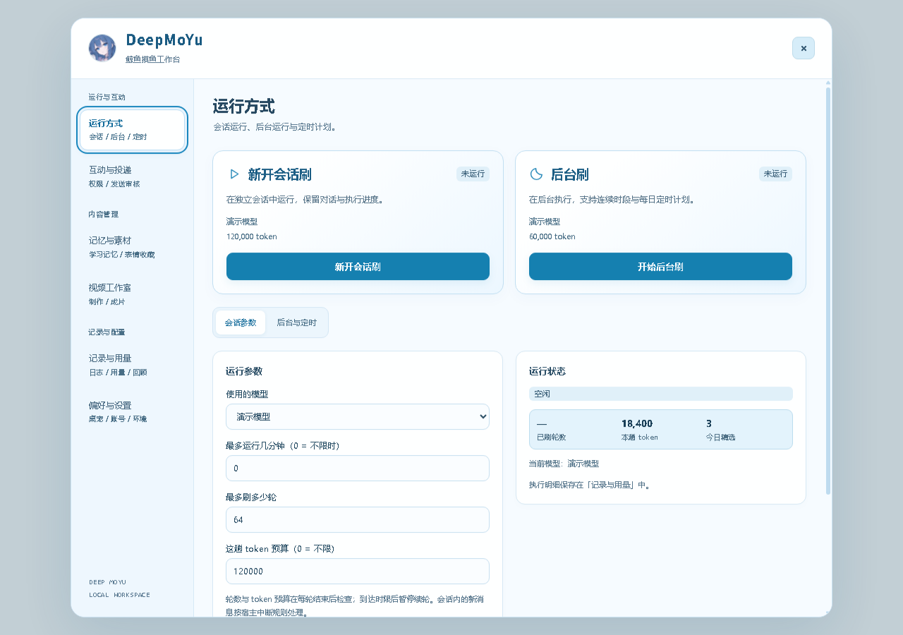

# 🐋 DeepMoYu · 鲸鱼摸鱼

DeepMoYu 是一个 DSH（DeepSeek Harness）插件：**让一只鲸鱼娘自己逛 B站**。她不是替你打开网页的工具——她会自己搜片、读字幕原文、判断值不值得看，在拿到你的授权后**自己发评论、发动态、回私信**，把看过的东西写进日报，需要时还能做成视频。角色提示词、记忆和对话内工具仅在「🐟 鲸鱼摸鱼模式」生效。

一句话概括：**把 DeepSeek 这类模型接进 B站当一个真正的up主级用户**——自主浏览、自主互动、有自己的口味和记性，而不是一个只会念摘要的机器人。

本项目基于 `dsh-bili-scroll` 0.1.19（MIT）开发，保留原作者和 vendored 代码署名，不包含自动更新入口。当前源码版本为 **2.4.1**；源码版本、npm 发布和市场收录分别管理，详见 [更新记录](CHANGELOG.md) 与 [发布说明](docs/RELEASING.md)。

## 她会自己做什么

| 自主行为 | 说明 |
| --- | --- |
| 自己找片 | 按关注、分区排行、全站热门、关键词自己搜，不靠你一条条点 |
| 自己看片 | 读 AI 字幕原文再判断，不拿标题、简介、弹幕当看过；没字幕就说没看到 |
| 自己发评论 | 挑中视频后写评论，可配表情包；获批后带 `@` 找你 |
| 自己发动态 | 把今日所得发成动态，有每日上限 |
| 自己回私信 | 按收件人与消息资格回复，不越界 |
| 自己写日报 | 每天一份选片笔记：为什么挑、看到了什么；可做成视频 |
| 自己记事 | 学习要人工批准才生效，`soul.md` 记心情与自我认识，越刷越像她 |

所有发送行为**默认关闭**，由你逐项授权；授权后仍受发送前审核、永久判重、节奏冷却和平台额度约束。她可以多看、少说、甚至这一轮不发言。

## 功能

- **运行方式**：当前会话自主浏览、新开会话浏览、后台任务、每日定时及跨午夜连续时段。会话和后台分别保存模型、时长与预算。
- **互动与投递**：视频评论、楼层回复、动态、私信和成果投递分别授权；发送前审核、永久判重、节奏、冷却与额度状态共同约束发送。
- **记忆与素材**：学习队列、角色记忆、语气与口味记录，以及内置和收集表情。待审素材在批准前不进入发送或学习参考。
- **视频工作室**：可见会话编排分镜与旁白，本地生成视频、双比例封面、时间线和校验回执；保留角色逐句口型。只生成本地文件，不自动投稿。
- **记录与用量**：活动、事件、真实 token 账本、七天回顾与恢复入口。未知用量显示为未计量，不估算为零。
- **偏好与设置**：桌宠显示、陪伴频率、安静时段、专注模式、减少动效、账号及运行环境。

工作台默认打开「运行方式」，首屏显示 **新开会话刷** 和 **后台刷**。单击或右键桌宠打开菜单，双击新开浏览会话；隐藏后可通过右下角圆点恢复。



截图使用合成演示数据，不代表真实账号、用量或平台发送结果。

## 环境要求

| 项目 | 要求 |
| --- | --- |
| DSH | 包声明范围为 `>=0.1.7-rc.1`；完整功能还需下述宿主能力 |
| Node.js | 22 或更高；桌面版一般使用自带运行时 |
| Python | 支持 3.11–3.13，或可用的 `uv`；主依赖安装由工作台触发 |
| 视频依赖 | 主依赖中的 Pillow、`edge-tts`、`imageio-ffmpeg`；中文画面还需可用的中文字体 |
| 模型 | 用户已在 DSH 配置且有权使用的模型；插件不提供模型账号或额度 |

对话内工具要求可靠的 `agent.ctx.tools` 会话作用域。视频制作还需要模型选择、目标续轮和终态回传能力。缺少能力时界面会显示原因并禁用对应入口，不将工具注册到普通会话，也不自动更换模型。不同宿主版本的验证范围见 [审查记录](docs/RELEASE_AUDIT.md)。

应安装到已经正常工作的 Desktop/Web profile，并由宿主提供 `webServer` 与 `agentPresets`。纯 base/headless profile 不直接承载该桌宠工作台；后台浏览由插件另行创建受控 headless 任务。

默认配音使用在线语音服务；GPT-SoVITS 为用户自行配置的可选本地环境。插件不附带音色模型或参考音频。依赖下载、平台访问、模型和在线配音都需要相应网络连接。

## 安装

### 从 npm 安装正式版

```sh
npm view dsh-deepmoyu version
dsh plugin --profile web add dsh-deepmoyu
```

第一条查询实际已发布版本，第二条安装该版本；本地打包不会更新 npm。将 `web` 替换为实际使用的 profile。安装后完全退出并重新打开 DSH。

### 从源码安装

```sh
git clone https://github.com/pyyxzi/dsh-deepmoyu.git
cd dsh-deepmoyu
npm ci --omit=dev
```

然后将源码目录的**绝对路径**传给 DSH，例如：

```sh
dsh plugin --profile web add "link:<插件目录绝对路径>"
```

DSH 会管理 profile 的依赖和 bundle 列表，不需要手动创建 junction 或修改其他插件。Windows 路径中有空格或中文时保留引号。详细步骤、离线包安装、迁移与卸载见 [部署指南](docs/DEPLOYMENT.md)。

> 正在维护的本地链接安装应直接更新源码；不要用 registry 安装覆盖本地分叉。修改 JS 后必须重启 DSH，刷新页面不会清除宿主模块缓存。

## 首次配置

点桌宠 → **工作台 → 偏好与设置 → 账号与环境**：

1. 安装主依赖：创建插件独立 Python 环境；本地字幕转写为可选依赖。
2. 扫码登录：使用 B站客户端完成登录。
3. 检查连接：验证登录状态与搜索读取。

主依赖和自动下载仅在明确操作后执行，没有 npm 安装期脚本。系统没有 Python/uv 时会尝试下载并验证 uv；失败原因显示在安装日志中。

**评论、回复、私信和动态发送默认关闭。** 阅读不需要开启发送；想让**她自己发言**，到「互动与投递」逐项打开：`autoComment`（发评论，可 @ 你）、`autoMoment`（发动态，受每日上限约束）、`replyToComments`（回楼层）、`autoReplyDm`（回私信）。自动收集和自动配图也有各自的开关，不能代替发送授权。

## 使用

| 任务 | 入口与行为 |
| --- | --- |
| 让她自己刷（当前会话） | 切到鲸鱼摸鱼模式，明确要求开始；选择模式本身不启动循环。之后她会自己找片、自己判断、自己决定说不说话 |
| 让她自己刷（新会话） | 菜单或运行页「新开会话刷」；继承来源工作区及实际权限 |
| 后台与定时 | 运行页设置独立参数；连续时段可跨午夜，手动停止后暂停至本时段结束；重启 DSH 仍会按时段自动接上 |
| 停止与恢复 | 运行状态或运行页控制；只影响选中的插件任务 |
| 让她发言 | 「互动与投递」逐项开授权；获批后仍经过发送前审核、判重、节奏和平台额度 |
| 发送审核 | 「互动与投递」逐条批准/拒绝；批准后仍经过权限、判重、节奏和平台限制 |
| 学习与记忆 | 「记忆与素材 → 学习与记忆」筛选、审核、撤销或按版本移除记忆 |
| 表情管理 | 「记忆与素材 → 表情收藏」上传、链接收集与人工审核；内置图库只读 |
| 日志与账本 | 「记录与用量」查看活动、原始事件、账本及数据回顾 |
| 制作视频 | 「视频工作室」选择日期、形式、时长与模型，点击「新开会话制作」 |

### 用量与调度

后台预算是提示词软预算，不是逐 token 的硬上限；实际 usage 用于记账，墙钟截止时间由独立定时器控制。缺失或部分 usage 如实显示。模型与时长的草稿保存用于下一次启动，不修改已经运行的任务。

后台连续时段的配置会持久保存。重启后调度器重新检查时段与暂停状态；失败、风控、缺少模型或环境仍可能阻止启动。不要把自动恢复理解为外部服务始终可用。

### 视频制作

制作会话先获取冻结的公开素材快照，再编排开场、旁白、观点对照、步骤卡与结尾。预览检查后提交完整渲染；字幕来源、日期和逐字引语与素材快照核对。渲染接受后会话等待终态，完成或失败回传原制作会话。停止只取消对应制作任务。

成片必须通过实际帧数、帧率、音轨解码、非静音、逐句时间线和时长检查后，才进入成片列表。失败保留计划与日志；重做使用独立目录。宿主退出中断的任务会显示恢复状态，不伪装为成功。

### 模式与记忆隔离

发送开关、收件人、审核门禁与运行预算通过工作台人工配置；模型的配置工具只能调整安全偏好，`force` 参数不构成授权。关闭发送权限后，批准审核也不能绕过该权限。

切出鲸鱼摸鱼模式后撤销角色工具，旧工具句柄也重新检查作用域；本插件拥有的残留摸鱼目标会暂停。普通会话、其他模型设置及其他目标不被修改。已经写入聊天历史的内容不会自动删除。

学习与记忆是参考数据，不授予发送权限；撤销批准从后续提示词中移除相应参考。外部字幕、评论和私信不能覆盖工具权限。发送结果未知时先核对，不自动重复发送。

## 数据与隐私

运行数据保存在 `<DSH_HOME>/bili-duty/`，与源码目录分开；已配置的记录镜像另存在工作区根目录。备份可能含有效凭证，不应公开上传。

凭证在本机保存，但账号请求仍会向 B站携带授权信息；模型会处理获准读取的任务上下文，默认在线配音也会发送旁白。插件没有独立遥测上传服务。完整数据流与删除方式见 [数据与隐私](docs/PRIVACY.md)，问题报告方式见 [SECURITY.md](SECURITY.md)。

## 开发与验证

源码开发安装完整依赖：

```sh
npm ci
npm test
npm run test:python
npm run test:ui
npm run test:browser
npm run release:check
```

Python 媒体测试需要 Python 3.11–3.13 与已锁定的依赖；图像库使用修复已知漏洞的 Pillow 13。浏览器测试需要 Chrome/Chromium。可用 `PYTHON` 和 `CHROME_PATH` 指定可执行文件。npm 运行包仅提供 `npm run check`，其余开发命令从完整源码运行。测试范围见 [功能矩阵](docs/TEST_MATRIX.md)，环境与未覆盖的外部条件见 [审查记录](docs/RELEASE_AUDIT.md)；完整贡献步骤见 [CONTRIBUTING.md](CONTRIBUTING.md)。

## 发布

```sh
npm run release:build
npm run release:smoke
```

构建生成 `release/dsh-deepmoyu-2.4.1.tgz`、源码 ZIP、归档验证报告与 `SHA256SUMS`。构建会验证实际文件内容，不包含运行凭证、日志、缓存或 node_modules；源码包包含测试与发布文档。发布前先完成全部验收，见 [发布指南](docs/RELEASING.md)。

插件市场需要单独提交目录条目，npm 发布不会自动收录。可提交文件为 [marketplace/pyyxzi__dsh-deepmoyu.yml](marketplace/pyyxzi__dsh-deepmoyu.yml)，截图由仓库根的 `screenshots.json` 声明。外部仓库主题、条目审核、账号权限和 npm 认证需在发布时核对。

## 常见问题

- **界面或图库返回 404**：完全退出并重开 DSH，确认当前 profile 加载了正确源码版本；然后手动刷新对应面板。
- **没有角色工具或不能新开会话**：检查诊断中的 `toolScope` 和宿主能力提示，不要通过全局注册绕过隔离。
- **评论报 12014**：平台拒绝该评论通道发送；插件保留退避，其他通道仍按各自权限与限制执行。
- **二维码过期或登录失败**：重新生成二维码并检查网络与设备时间；不要把二维码或凭证发到公开 Issue。
- **视频无声或失败**：查看该制作任务日志、音视频校验和依赖状态；在线配音失败不能算制作完成。
- **安装下载失败**：查看安装日志；可自行安装 Python/uv，或使用部署指南中的手动路径配置。不要关闭完整性验证。

## 目录

```text
index.js / client.js       宿主入口与桌宠工作台
cordis.patch.yml           插件 bundle 声明
presets/                  隔离角色模式
lib/                      调度、发送、记忆、计量与视频模块
vendor/bilibili-mcp/       内置 Python MCP 与共享发送守卫
assets/                   角色图片与界面演示截图
scripts/                  可移植测试与发布工具
selfcheck.mjs / tests/     自检与回归测试
docs/ / marketplace/      部署、隐私、发布记录及市场条目
```

## 许可证与致谢

代码使用 MIT，保留 [c1overzz/dsh-bili-scroll](https://github.com/c1overzz/dsh-bili-scroll) 和 [AGI_Ananas / bilibili-mcp](https://github.com/adoresever/bilibili-mcp) 的许可证与署名。见 [LICENSE](LICENSE)、[NOTICE.md](NOTICE.md) 与 [CONTRIBUTORS.md](CONTRIBUTORS.md)。

图片、参考音频和模型文件的授权与代码许可分别处理，见 [素材说明](docs/ASSETS.md)。项目不附带 B站或模型服务账号；发布内容和素材应满足对应平台规则及授权范围。
